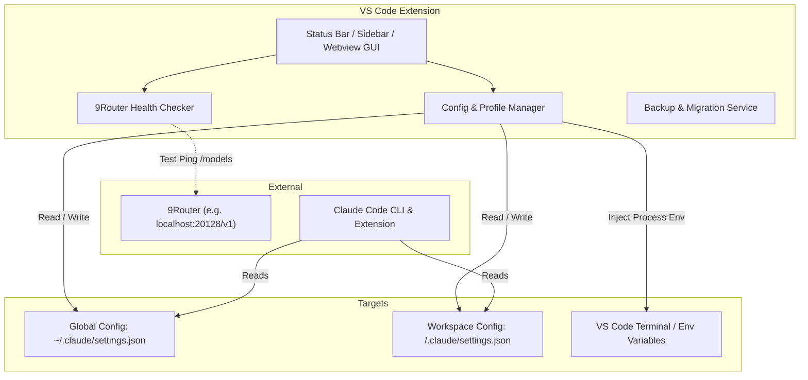

# Implementation Plan: Claude Code Config Manager (VS Code Extension)

A dedicated VS Code extension to manage, configure, and switch Claude Code configuration profiles seamlessly—with first-class support for **9Router** (`http://localhost:20128/v1` and custom router endpoints), custom models, environment variables, permissions, and multi-workspace support.

---

## 1. Goal & Architecture Overview

Claude Code CLI and VS Code Extension read configuration primarily from:
1. **Global Configuration:** `~/.claude/settings.json` (and `~/.claude.json`)
2. **Workspace Configuration:** `${workspaceFolder}/.claude/settings.json`

The goal of this extension is to provide a smooth, GUI-driven and Command Palette-driven way to:
- Configure custom API Base URLs (especially **9Router** proxy endpoints).
- Switch between multiple AI providers / models / endpoints instantly.
- Toggle permissions, effort levels, allowed directories, and bypass options.
- Test endpoint connectivity with 9Router / LLM proxies.
- Apply configs globally or per-workspace without manually editing JSON files.



---

## 2. Key Features

### 🌟 1. 9Router & Custom Endpoint Presets
- **Pre-configured 9Router Template**:
  - `ANTHROPIC_BASE_URL`: `http://localhost:20128/v1`
  - `ANTHROPIC_MODEL`: `ag/gemini-3.7-flash-medium`, `claude-3-7-sonnet`, etc.
  - `ANTHROPIC_API_KEY`: API token.
- **Custom Profile Management**: Save unlimited presets (e.g. "9Router Gemini 3.7", "9Router Claude Sonnet", "Anthropic Official", "Local Ollama Proxy").
- **1-Click Profile Switching**: Switch profile directly from the VS Code Status Bar.

### ⚙️ 2. Claude Code Environment & Permissions Tweaks
- **Permissions Management**:
  - `defaultMode`: `bypassPermissions` / `ask` / `dontAsk`
  - `allow`: Array of allowed tools (e.g. `["*"]`, `["Bash", "GlobTool"]`)
  - `additionalDirectories`: Add/remove workspace folders or custom paths.
  - `skipDangerousModePermissionPrompt`: `true` / `false`
- **Model & Reasoning**:
  - `model`: Model name / path
  - `effortLevel`: `low` / `medium` / `high`
- **UI & Theme**:
  - `theme`: `light-ansi`, `dark-ansi`, etc.
  - `autoUpdatesChannel`: `latest`, `stable`

### 🔍 3. Scope Management (Global vs Workspace)
- Choose target:
  - **Global**: Applies to all terminal sessions & projects (`~/.claude/settings.json`).
  - **Workspace**: Creates or updates `${workspaceFolder}/.claude/settings.json`.

### 🩺 4. Health Check & Validation
- "Test 9Router Connection" button: Sends a lightweight probe to `http://localhost:20128/v1/models` or health endpoint to confirm the proxy is online and reachable.
- JSON Schema validation with autocomplete and error highlighting.
- Automatic backup (`settings.json.bak.<timestamp>`) before applying changes.

---

## 3. Technology Stack & Project Structure

- **Language:** TypeScript (`v5.x`)
- **Runtime:** VS Code Extension API (`^1.85.0`)
- **Bundler:** `esbuild` for ultra-fast startup and lightweight VSIX packaging.
- **UI:** VS Code Webview with modern theme-aware CSS / TreeView & QuickPick API.

### Target Directory Structure:
```
vscode-claude-config/
├── .vscode/
│   ├── launch.json
│   └── tasks.json
├── src/
│   ├── extension.ts             # Entry point & command registrations
│   ├── constants.ts             # Default presets (9Router, Anthropic, etc.)
│   ├── types.ts                 # ClaudeConfig schema & Profile interfaces
│   ├── services/
│   │   ├── configManager.ts     # Read/write/merge ~/.claude/settings.json
│   │   ├── profileStorage.ts    # Store & retrieve user profiles
│   │   ├── healthChecker.ts     # Test 9Router / LLM endpoint connectivity
│   │   └── backupService.ts     # Config backup and rollback
│   ├── ui/
│   │   ├── statusBar.ts         # Active profile status bar button
│   │   ├── quickPick.ts         # Quick switch profile menu
│   │   ├── treeView.ts          # Sidebar explorer for Profiles & Settings
│   │   └── webview/             # Visual configuration panel
│   │       ├── panel.ts
│   │       └── media/
│   └── utils/
│       └── pathHelper.ts        # Cross-platform home/workspace path resolution
├── package.json                 # Extension manifest & contribution points
├── tsconfig.json
├── esbuild.js
└── README.md
```

---

## 4. Proposed Implementation Phases

| Phase | Description | Key Deliverables |
|---|---|---|
| **Phase 1: Project Scaffolding & Core Schema** | Initialize extension project, TypeScript config, schema definition for Claude Code `settings.json`. | Extension boilerplate, types, default presets including 9Router. |
| **Phase 2: Config Manager & File System Operations** | Implement safe read, write, merge, and backup of `~/.claude/settings.json` and `.claude/settings.json`. | `ConfigManager`, `BackupService`, path normalization for Windows/Mac/Linux. |
| **Phase 3: QuickPick & Status Bar Switching** | Add Status Bar item with active profile indicator and QuickPick selector to switch endpoints in 1 click. | `Claude: 9Router (Gemini 3.7)` status bar indicator + Switch command. |
| **Phase 4: Webview Visual Settings Editor** | Rich Webview UI to manage 9Router URLs, API Keys, Models, Permissions, and Allowed Directories. | Form editor with real-time JSON preview & validation. |
| **Phase 5: 9Router Connectivity & Diagnostic Tools** | Endpoint connectivity tester, model list fetcher from 9Router, and diagnostics logger. | "Test Connection" command and output channel. |
| **Phase 6: Packaging & Verification** | Build `.vsix` package and verify in VS Code runtime. | Complete `.vsix` ready to install. |

---

## 5. User Review Required

> [!IMPORTANT]
> **Project Location**: Please confirm where you want this extension project folder to be created:
> - Option A (Recommended): Create in a new dedicated directory (e.g. `d:\SAI\projects\vscode-claudecode-config` or `d:\git\vscode-claudecode-config`).
> - Option B: Inside the current workspace root under a subfolder.

> [!TIP]
> **9Router Default Settings**: We will set the default template to:
> - `Base URL`: `http://localhost:20128/v1`
> - `Default Model`: `ag/gemini-3.7-flash-medium`
> - `Permissions`: `bypassPermissions`, `allow: ["*"]`
> - `effortLevel`: `high`
